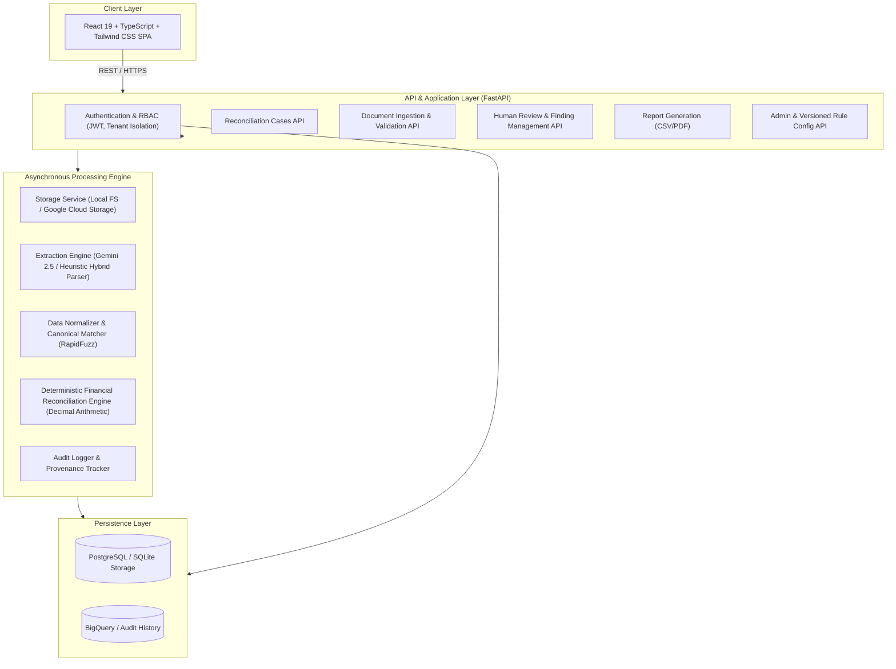

# Architecture Blueprint: Contract & Invoice Leakage Finder

## 1. System Overview

**Contract & Invoice Leakage Finder** is a production-grade B2B SaaS platform designed for finance managers, accounts payable analysts, and procurement directors to systematically detect financial leakage across supplier contracts, purchase orders, invoices, and goods received notes (GRNs).

The application operates as an **evidence-grounded exception detection system**. It does **not** assert allegations of fraud, but flags discrepancies with linked document citations, audit logs, and allows authorized human reviewers to approve, reject, or request further information.

---

## 2. High-Level Architecture

---

## 3. Data Ingestion & Reconciliation Pipeline

1. **Upload & Quarantine**: Files (PDF, CSV, XLSX) are validated for MIME type, sanitized, SHA-256 hashed to prevent duplicates, and saved to secure storage (GCS in cloud, isolated filesystem in dev).
2. **AI Document Extraction**: 
   - Uses Google Gemini API (via current official `google-genai` SDK) to parse unstructured PDF contracts, purchase orders, and invoices into structured Pydantic schemas.
   - Includes local heuristic/OCR extraction fallback for offline or air-gapped environments without API keys.
   - Stores extraction confidence, exact page/coordinate or row/sheet source reference, and review flags.
3. **Normalization & Matching**:
   - Canonicalizes supplier names (exact match first, then configured threshold fuzzy match), dates (ISO 8601), currencies, and unit quantities.
   - Links invoice line items to purchase order line items and contracted pricing schedules.
4. **Deterministic Financial Reconciliation**:
   - 100% Python `Decimal` arithmetic — zero floating-point imprecision.
   - Compares:
     - Contracted unit price vs. invoice unit price
     - Purchase order unit price vs. invoice unit price
     - Invoiced quantity vs. ordered quantity
     - Invoiced quantity vs. received quantity (GRN)
     - Duplicate invoice references/hashes
     - Math verification (unit price × quantity = line total; sum of lines + tax = invoice total)
     - Missing credit note adjustments
   - Evaluates active versioned tolerance rules (e.g., 0.5% price tolerance or £1.00 absolute tolerance).
5. **Human Review Workflow**:
   - Findings generated with status `NEW`.
   - Authorized reviewers (Admin, Manager, Reviewer) can inspect side-by-side evidence, adjust extracted values, add notes, and mark `CONFIRMED`, `REJECTED`, or `NEEDS_MORE_INFO`.
6. **Reporting & Auditing**:
   - Export reports as structured CSV and formal audit-ready PDF summary packages.
   - Complete immutable audit trails for every status change, rule modification, and data update.

---

## 4. Multi-Tenant Security & Role-Based Access Control (RBAC)

- **Tenancy Boundary**: Every query is scoped by `organization_id` and verified against user workspace permissions.
- **Roles**:
  - `ADMIN`: Organization setup, user management, workspace creation, editing rule configs.
  - `MANAGER`: Case creation, run reconciliation, assign reviews, export reports.
  - `REVIEWER`: Inspect evidence, approve/reject findings, add comments.
  - `VIEWER`: Read-only access to cases, findings, and reports.
- **IDOR Defense**: All API requests validate ownership of resource hierarchical path: Organization -> Workspace -> Case -> Document / Finding.

---

## 5. Technology Stack

- **Frontend**: React 19, TypeScript, Tailwind CSS, Lucide Icons, Vite, React Router 7.
- **Backend**: Python 3.12-3.14, FastAPI, SQLAlchemy 2.0, Alembic, Pydantic v2.
- **AI / Extraction**: Google Gemini API (`google-genai`), PyPDF, OpenPyXL, RapidFuzz.
- **Database**: PostgreSQL (Production) / SQLite (Development zero-config & CI tests).
- **Cloud Infrastructure**: Google Cloud Run, Cloud Storage, Cloud Tasks, BigQuery, Secret Manager, Terraform.
- **DevOps**: Docker multi-stage builds, GitHub Actions CI/CD with security linting and test automation.

