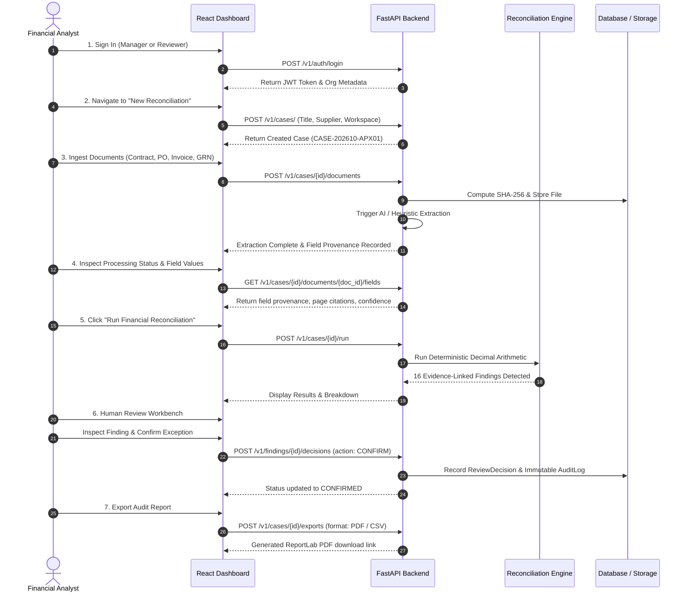

# Demonstration & User Acceptance Walkthrough

## Overview

This guide walks through the end-to-end user journey for **Contract & Invoice Leakage Finder**, replicating the exact scenario outlined in Section 17 of the specification.

---

## Demonstration Credentials (Pre-Seeded)

The database is pre-seeded with 4 user roles belonging to tenant organization **Apex Global Retail Ltd**:

| Role | Email | Password | Scope & Responsibilities |
| :--- | :--- | :--- | :--- |
| **Admin** | `admin@apexretail.co.uk` | `Password123!` | Rule configurations, tolerance versions, user management. |
| **Manager** | `manager@apexretail.co.uk` | `Password123!` | Creating audit cases, running reconciliation, generating reports. |
| **Reviewer** | `reviewer@apexretail.co.uk` | `Password123!` | Inspecting evidence citations, approving/rejecting findings. |
| **Viewer** | `viewer@apexretail.co.uk` | `Password123!` | Read-only audit access to reports and history. |

---

## Step-by-Step Demonstration Flow

---

## Walkthrough Scenario: Concrete Leakage Example

### The Scenario:
- **Supplier**: Apex Industrial Supplies Ltd
- **Agreed Contract Unit Price**: £50.00 (Contract `CTR-APX-2026-01`, item `ITM-APX-01`)
- **Authorized Purchase Order Price**: £50.00 (PO `PO-2026-101`, quantity 100 units)
- **Supplier Invoice**: Invoiced unit price £55.00 for quantity 100 units
- **Expected Amount**: £50.00 × 100 = £5,000.00
- **Invoiced Amount**: £55.00 × 100 = £5,500.00
- **Potential Leakage Overcharge**: **£500.00**

### In the Application:
1. Log in as `manager@apexretail.co.uk`.
2. Open the case **"Apex Industrial Supplies Q4 Review"**.
3. Go to **"Reconciliation Results"**.
4. Observe the **Contract Price Mismatch** finding:
   - Expected: `£5,000.00`
   - Invoiced: `£5,500.00`
   - Variance: `+£500.00` (Severity: `HIGH`)
5. Click **"Inspect"** to view side-by-side math and exact citations to `CTR-APX-2026-01` and invoice `INV-2026-1032`.
6. Add reviewer note: `"Confirmed variance with procurement rate card."` and click **"Confirm Exception"**.
7. Navigate to **"Reports & Exports"**, click **"Export Formal PDF Report"**, and download the audit-ready summary package!

